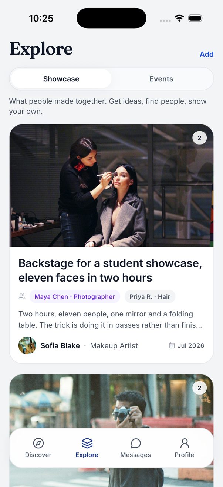
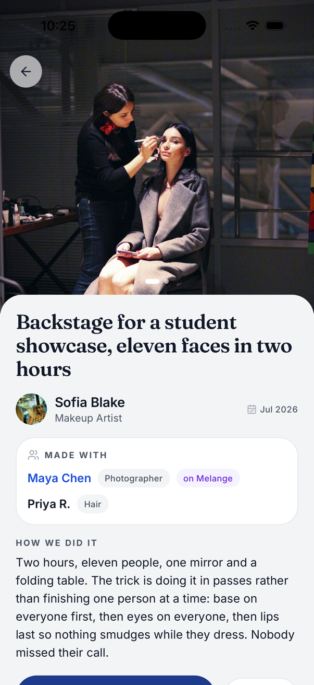

# Melange

**Small nights for people who make things.** A host, a place and a start
time; a friend sends you the link; you go, meet the people there, and find
them again in the app afterwards.

iOS app on the [App Store](https://apps.apple.com/app/id6774481477) ·
website at [melange-psi.vercel.app](https://melange-psi.vercel.app) ·
built and run by one engineer (Raunak Sood), with Jolea on community.

<p>
  
  
  
</p>

---

## What it does

1. **A friend sends you a night.** The link shows the place, the time, the
   host and the first names of who's going. You can say yes with a name and
   an email — no app needed yet.
2. **Before it, you meet the room.** In the app you see who's going and talk
   in the night's group chat.
3. **After it, the night stays with the people who were there.** Its photos
   are private to them, people tag each other, and for three days you can
   quietly heart anyone you'd see again. A heart is only revealed if it's
   mutual.
4. **Between nights,** Discover finds people in your scene and Explore is
   the scene's wall of work, credited to everyone who made it.

## By the numbers

| | |
|---|---|
| App Store releases | 9 shipped: 1.0 in May 2026, then 1.2 → 1.8 between Oct 9 and Oct 20 |
| Database migrations | 25, every one idempotent; the last five tested against production inside a rolled-back transaction before applying |
| Code | ~35k lines of TypeScript and SQL across an Expo app, a Next.js site and Postgres |
| Production bugs found by querying the live database | ~40, most of them the "reports success, does nothing" kind |
| Users | early: about a dozen accounts. This is a working product, not a traction story yet. |

## Engineering worth looking at

**Privacy and safety enforced by the database, not the client.** Both apps
talk straight to Postgres with a public key, so every rule lives in row-level
security and `SECURITY DEFINER` functions
([`supabase/schema`](supabase/schema)). A few examples:

- **Mutual-only reveals.** Hearts between people from the same night go in a
  table with RLS on and *no read policy at all*; the only way in is a
  function that tells you about a heart when it's mutual
  ([`23_scenes_invites_nights.sql`](supabase/schema/23_scenes_invites_nights.sql)).
  The first design reused the app's general hearts table — which notifies the
  recipient on insert — and would have leaked every one-way heart.
- **Private night photos.** A storage bucket whose read policy derives
  membership from the object path, so a photo is visible only to the host and
  the people going, and nobody can upload under someone else's name
  ([`25_web_rsvp_and_night_photos.sql`](supabase/schema/25_web_rsvp_and_night_photos.sql)).
- **Server-only fields.** Verification status and founding status are guarded
  by triggers that ignore client writes, after an audit found any user could
  give themselves the verified badge with one API call
  ([`21_trust_and_support.sql`](supabase/schema/21_trust_and_support.sql)).

**Testing migrations against production without changing it.** Every recent
migration was run inside `BEGIN … ROLLBACK` against the live database with
behavior tests that impersonate real roles (`SET LOCAL ROLE authenticated`,
forged JWT claims): can an outsider read the night chat, can a spoofed upload
path get through, does a second invite code get refused. That caught a policy
someone had added in the dashboard — present in production, in no migration —
that let signed-out visitors read every profile.

**The bug class that shaped the codebase.** The recurring defect was
"something reports success while doing nothing": a zero-row `UPDATE` returns
no error; a `void supabase.rpc(...)` never sends because the builder is lazy
(that one silently dropped five months of analytics); push webhooks configured
by a comment telling a human to click through a dashboard, which nobody did.
The fixes moved configuration into migrations
([`12_push_webhooks.sql`](supabase/schema/12_push_webhooks.sql)) and made
"await it and check the error" a house rule.

**A security pass a reviewer would actually find.** The published support
address was on a parked domain someone else owned (mail to it could never
arrive, and its buyer could have reset the review accounts); demo passwords
were in the public repo; toggling a heart could buzz someone's phone
indefinitely; a heart you *sent* lifted the cold-message limit. Each is fixed
and the reasoning is in the migration that fixed it.

**Shipping from the command line.** EAS builds, an App Store Connect API
script ([`scripts/asc.mjs`](scripts/asc.mjs)) that creates versions, attaches
builds and submits for review, and `fastlane` for screenshots — so a release
is a few commands, not an afternoon in a web console.

## Product decisions, and why

Melange started as "swipe to find creative collaborators." Research said
that wouldn't work: a free collaboration has no transaction to build a
business on, Instagram already does the introduction, and similar apps had
stalled for the same reasons ([`docs/MARKET_RESEARCH_2026-10.md`](docs/MARKET_RESEARCH_2026-10.md)).

A second pass studied ~50 consumer social and in-person companies from
2023–2026 — what grew, what faded and why
([`docs/RESEARCH_2026.md`](docs/RESEARCH_2026.md)). The current design follows
what the evidence pointed to:

- **The invite works before the download** (Partiful's loop) → anyone can
  RSVP from a night's web page.
- **Private content of you and your people beats public feeds** (Locket,
  Retro) → night photos are visible only to the people who were there.
- **A recurring real-world occasion beats a clever mechanic** (Poparazzi,
  BeReal, Clubhouse faded; Timeleft, run clubs grew) → the product is built
  around nights, and the app is where they continue.
- **Dense in one place before anywhere else** → scenes, starting with LA.

## How it's built

| | Website | iOS app | Backend |
|---|---|---|---|
| | Next.js (App Router), Tailwind | Expo / React Native, expo-router | Supabase: Postgres, Auth, Storage, Realtime, Edge Functions |
| Hosting | Vercel | App Store | Supabase |

Both clients share one database and no other code. Push notifications are
Postgres triggers that call an Edge Function (`supabase/functions/send-push`),
which sends through Expo. More in [`docs/ARCHITECTURE.md`](docs/ARCHITECTURE.md).

## Running it

```bash
npm install
cp .env.example .env.local   # Supabase URL + anon key
npm run dev                  # website on http://localhost:3000

cd mobile && npm install && npx expo start   # iOS app
```

Database changes are plain SQL files in `supabase/schema`, applied in order
(`scripts/apply_migration.mjs`). Setup details in [`docs/SETUP.md`](docs/SETUP.md).
